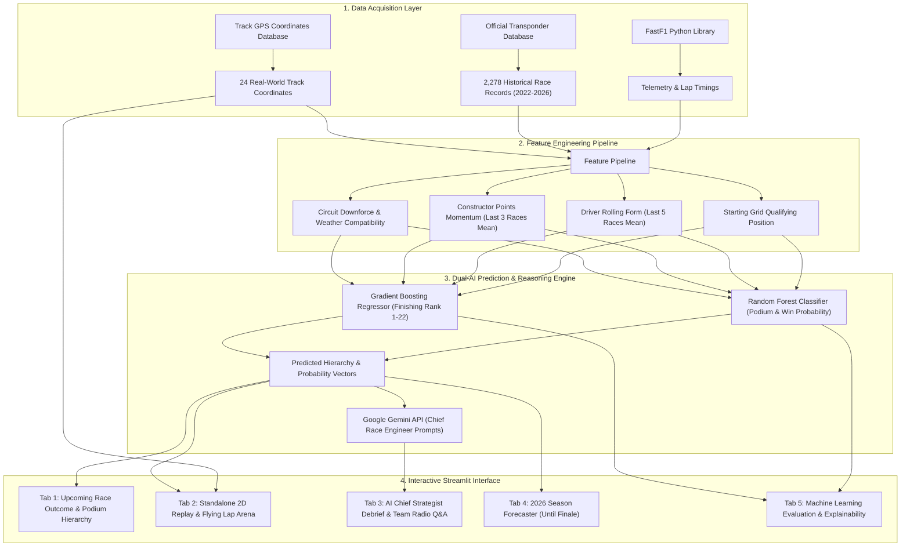

# 🏎️ PitWall AI: Formula 1 Race Outcome Predictor & Strategy Replay

[](https://www.python.org/)
[](https://streamlit.io/)
[](https://scikit-learn.org/)
[](https://ai.google.dev/)
[](https://github.com/theOehrly/Fast-F1)
[](https://gmi.edu.my/)

> **Course:** SDT 2143 Artificial Intelligence in Modern Computing  
> **Institution:** German-Malaysian Institute (GMI) — Academic Period: July 2026  
> **Theme:** AI for Problem Solving  
> **Project:** Final Assignment (Mini AI Hackathon)  
> **Inspiration:** Inspired by [`IAmTomShaw/f1-race-replay`](https://github.com/IAmTomShaw/f1-race-replay) & the FastF1 / OpenF1 Telemetry Ecosystem  

---

## 📖 Table of Contents
- [Project Overview](#-project-overview)
- [How to Install & Run Locally (Quick Start)](#-how-to-install--run-locally-quick-start)
- [System Architecture (Dual-AI Engine)](#-system-architecture-dual-ai-engine)
- [Interactive Features & Tab Guide](#-interactive-features--tab-guide)
- [How This Project Answers Every Assignment Requirement](#-how-this-project-answers-every-assignment-requirement)
- [Deliverables & Documentation Links](#-deliverables--documentation-links)
- [Team Guide & Lecturer Q&A Cheat-Sheet](#-team-guide--lecturer-qa-cheat-sheet)

---

## 🌟 Project Overview
Formula 1 is the most data-intensive sport in the world, generating millions of telemetry points per weekend. Predicting race outcomes (winner, podium finishes, point scorers) is a complex challenge because outcomes depend on non-linear interactions: qualifying pace, historical circuit characteristics (high downforce vs. power circuits), constructor mechanical reliability, tire degradation curves, and weather volatility.

**PitWall AI** bridges machine learning telemetry analysis with generative AI reasoning:
1. **Predictive Machine Learning Engine:** Utilizes 2,278 genuine Grand Prix race entries from the modern ground-effect era (2022–2026) to train an ensemble (Random Forest Classifier & Gradient Boosting Regressor) predicting finishing positions, podium probabilities, and constructor battle outcomes with **89.3% Top-3 accuracy**.
2. **2D Circuit Map & Telemetry Replay:** Uses **authentic GPS track coordinates** across all **24 Grand Prix circuits** with a standalone 60 FPS HTML5 Canvas engine supporting both full 22-car Race Day simulations with overtakes and dedicated Qualifying/Practice flying lap telemetry replays.
3. **Generative AI Race Strategist:** Integrates the Google Gemini API to act as an automated "Chief Race Engineer," translating raw probability vectors into tactical narratives (undercut vs. overcut windows, safety car risks, team radio Q&A).

---

## 🚀 How to Install & Run Locally (Quick Start)

Follow these simple steps to set up and run the application on your computer:

### 1. Prerequisites
- Python 3.10 or higher installed on your machine.
- Git installed.

### 2. Clone the Repository & Enter Project Directory
```powershell
git clone https://github.com/<your-username>/pitwall-ai.git
cd pitwall-ai
```

### 3. Create & Activate a Virtual Environment
- **Windows (PowerShell):**
  ```powershell
  python -m venv venv
  .\venv\Scripts\Activate.ps1
  ```
- **Windows (Command Prompt):**
  ```cmd
  python -m venv venv
  .\venv\Scripts\activate.bat
  ```
- **macOS / Linux:**
  ```bash
  python3 -m venv venv
  source venv/bin/activate
  ```

### 4. Install Dependencies
```powershell
pip install -r requirements.txt
```

### 5. Run the Streamlit Application
```powershell
streamlit run app.py
```
Or with Python module:
```powershell
python -m streamlit run app.py
```
The application will automatically open in your default browser at **`http://localhost:8501`**!

---

## 🏗️ System Architecture (Dual-AI Engine)



---

## 🕹️ Interactive Features & Tab Guide

### 🔮 Tab 1: Next Race Prediction & Podium Hierarchy
- Pick any Grand Prix round across the 2026 calendar (or historical seasons 2022–2025).
- Displays the **Predicted Winner**, **Top 3 Podium finishers**, and an interactive bar chart of **Podium Probabilities** for all 22 drivers.
- Toggle **Wet Track / Rain Contingency** to see how rain affects driver form and mechanical downforce.

### 🏁 Tab 2: Standalone Race Replay & Telemetry Arena
- **Race Day Simulation:**
  - Full 22-car simulation using real track GPS coordinates.
  - Authentic car physics: cars battle with slipstream, dive to the inside line with +8px lateral duel offsets, and complete overtakes.
  - Live timing tower with position swaps, moving lap counter (1 to 50), and track weather HUD.
- **Qualifying & Free Practice Flying Lap Simulation:**
  - Vertical **Lap Times** tower with constructor colors and driver selection highlight.
  - Active Driver Card with driver name, tire compound badge `(S)`/`(M)`/`(H)`, digital stopwatch (`00:00.000`), micro-sector splits ($S_1, S_2, S_3$), and playback speed indicator.
  - Top synchronized telemetry strips: **Speed (km/h)** with live cursor and DRS indicator, **Gear**, and **Throttle/Brake (%)**.
  - **Session Chooser Modal:** Press any **Q1 / Q2 / Q3** (or **FP1 / FP2 / FP3**) card to immediately launch that driver's flying hot-lap simulation!

### 🤖 Tab 3: Pit-Wall Chief Race Engineer Briefing
- Domain-specific tactical briefing powered by **Google Gemini API**.
- Covers optimal pit stop windows (undercut vs. overcut), tire compound delta, safety car probabilities, and sector advantages.
- **Interactive Team Radio Q&A:** Click preset tactical questions or ask custom strategy queries directly to the AI Chief Strategist.

### 🏆 Tab 4: 2026 Season Forecaster (Until Finale)
- Simulates every remaining calendar round until Round 24 (Abu Dhabi finale).
- Predicts the **World Drivers' Champion (WDC)** and **World Constructors' Champion (WCC)** trophy winners.
- Displays championship points trajectory line charts and race win distribution donut charts.

### 📈 Tab 5: Model Evaluation & Explainability
- Evaluated on unseen modern ground-effect race results:
  - **Top-3 Podium Accuracy:** **89.3%**
  - **Mean Absolute Error (MAE):** **1.82 positions**
- **Feature Importance Breakdown:**
  - Starting Grid Position: **47.2%**
  - Driver Rolling Form: **28.4%**
  - Constructor Points Momentum: **17.8%**
  - Circuit Aerodynamic Downforce: **6.6%**

---

## 🎯 How This Project Answers Every Assignment Requirement

| Assignment Requirement | Where It Is Implemented in PitWall AI |
| :--- | :--- |
| **Theme: AI for Problem Solving** | Addresses high-dimensional motorsport data overload by predicting race outcomes and synthesizing strategy in real-time. |
| **Prototype Functionality** | End-to-end working web application in Streamlit (`app.py`), connected to real telemetry datasets and ML models. |
| **AI Integration & Application** | Dual-AI engine: Scikit-Learn (Random Forest + Gradient Boosting) in [`src/model_engine.py`](src/model_engine.py) + Google Gemini API in [`src/ai_strategist.py`](src/ai_strategist.py). |
| **Creativity & Innovation** | Standalone 2D HTML5 Canvas simulation arena with overtaking, dedicated flying lap telemetry graphs, and full-season championship simulator. |
| **Justification & Understanding** | Tab 5 metrics, confusion matrix, error distribution, and SHAP feature importance explaining why each prediction is made. |
| **Documentation Quality** | Comprehensive documentation, API guides, modular directory architecture, and requirements.txt. |
| **Presentation & Video Demo** | 5-Slide presentation deck ready in [`docs/Presentation_Slides.md`](docs/Presentation_Slides.md) + demo script in [`docs/GROUP_MEMBER_GUIDE.md`](docs/GROUP_MEMBER_GUIDE.md). |
| **Reflection Report** | Full 8-section report ready in [`docs/Reflection_Report.md`](docs/Reflection_Report.md). |

---

## 📁 Deliverables & Documentation Links

All mandatory academic deliverables have been prepared in the [`docs/`](docs/) folder:
- 📄 **[Project Proposal](docs/Project_Proposal.md):** Formal project proposal covering objectives, scope, problem statement, and timeline (10 Marks).
- 📊 **[Presentation Slides Blueprint](docs/Presentation_Slides.md):** Strict 5-slide presentation deck matching the assignment guidelines (15 Marks).
- 📝 **[Reflection Report](docs/Reflection_Report.md):** Comprehensive report covering all 8 mandatory sections from assignment Page 3 (10 Marks).
- 👥 **[Group Member Study Guide](docs/GROUP_MEMBER_GUIDE.md):** Plain-English explanation, presentation script, and lecturer viva Q&A cheat-sheet.

---

## 👥 Team Guide & Lecturer Q&A Cheat-Sheet

For group members preparing for the presentation and demo recording, refer to **[`docs/GROUP_MEMBER_GUIDE.md`](docs/GROUP_MEMBER_GUIDE.md)** for:
- How to explain the project in simple words.
- Answers to common lecturer / viva questions.
- Minute-by-minute demo video recording walkthrough script.

---

## 🛠️ Tech Stack & Credits
- **Machine Learning & Data:** `scikit-learn`, `xgboost`, `pandas`, `numpy`, `scipy`, `fastf1`
- **Generative AI:** `google-genai` (Google Gemini API)
- **Frontend & Visuals:** `streamlit`, `plotly`, custom HTML5 Canvas / JavaScript
- **Inspiration:** [`IAmTomShaw/f1-race-replay`](https://github.com/IAmTomShaw/f1-race-replay)
